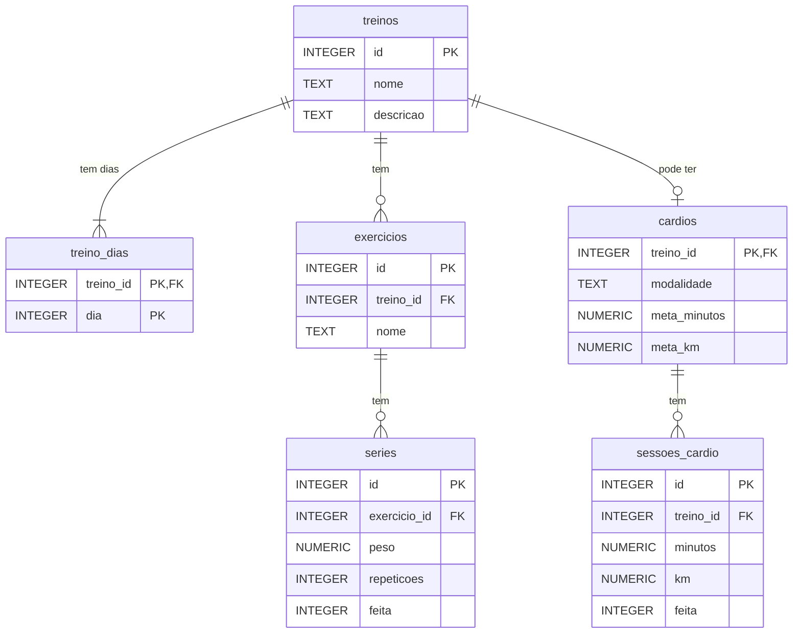

# Etapa 07 — Persistência e CRUD com banco de dados

## 1. Objetivo e visão geral

O objetivo desta etapa é substituir o armazenamento temporário da API por um banco de
dados real.

| Antes (Etapa 06) | Agora (Etapa 07) |
|---|---|
| Dados em `server/db.json`, um arquivo JSON regravado inteiro a cada escrita | Banco SQLite em `server/gymlog.db`, com 6 tabelas relacionadas |
| Um `threading.Lock` para impedir gravações simultâneas | Transações do banco: cada operação é gravada inteira ou desfeita inteira |
| Regras só no código Python | Regras também no banco (`NOT NULL`, `CHECK`, `FOREIGN KEY`) |
| As rotas liam e alteravam o JSON diretamente | Camadas separadas: as rotas não têm SQL, e o repositório não conhece HTTP |
| Erro de arquivo virava um `500` genérico | Erros de persistência específicos: `500`, `503` e `409` |
| Número da série guardado e renumerado a cada remoção | Número calculado na consulta (`ROW_NUMBER`) |

O contrato da API não mudou. A interface (`src/`) e a coleção do Postman funcionam sem
nenhuma alteração, e os testes das etapas anteriores continuam passando.

## 2. Escolha do banco: SQLite (relacional)

O domínio tem relações claras e fixas: um treino tem dias e exercícios, um exercício tem
séries, e um treino pode ter um cardio com sessões. Um banco **relacional** garante essas
relações no próprio banco: um exercício não existe sem treino, excluir um treino remove
tudo o que pertence a ele, e um peso negativo é recusado mesmo que escape da validação.

Entre os relacionais, o **SQLite** foi escolhido porque:

- **Já vem no Python** (módulo `sqlite3`), então o projeto continua sem dependências externas.
- **É um arquivo só,** sem servidor de banco para instalar, configurar ou manter rodando.
- **É um banco completo:** transações ACID, chaves estrangeiras, `CHECK`, índices e SQL padrão.
- **Basta para o uso:** é um aplicativo pessoal, local e com um usuário.

| Alternativa | Por que não foi escolhida |
|---|---|
| PostgreSQL ou MySQL | Exigem instalar e manter um servidor de banco, o que só se justifica com vários usuários ou acesso em rede |
| MongoDB (NoSQL de documentos) | O treino com seus filhos tem formato de documento e caberia bem, mas exigiria servidor e biblioteca externa. Além disso, regras como "peso maior que zero" e a exclusão em cascata ficariam só no código |
| TinyDB ou outro NoSQL em arquivo | Dependência externa, sem as restrições e as transações que o SQLite oferece |
| Continuar com o JSON | Não é um banco: não tem transações, restrições nem consultas, e regrava o arquivo inteiro a cada mudança |

Se o projeto um dia tiver vários usuários em rede, a migração para PostgreSQL ficaria
restrita a `banco.py` e `repositorio.py` (seção 6).

## 3. Modelo do banco



Versão em texto, para ler fora do GitHub:

```
treinos 1 ──── 1..N treino_dias
   │
   ├── 1 ──── 0..N exercicios 1 ──── 0..N series
   │
   └── 1 ──── 0..1 cardios 1 ──── 0..N sessoes_cardio
```

O script completo, com todas as restrições comentadas, está em
[`server/schema.sql`](../server/schema.sql).

## 4. Entidades

**`treinos`**: o recurso principal da API.

| Coluna | Tipo | Restrições | Descrição |
|---|---|---|---|
| `id` | INTEGER | chave primária, `AUTOINCREMENT` | Identificador gerado pelo banco |
| `nome` | TEXT | `NOT NULL`, não vazio | Nome do treino, como "Treino A" |
| `descricao` | TEXT | `NOT NULL`, padrão `''` | Descrição opcional, como "Peito + Tríceps" |

**`treino_dias`**: os dias da semana em que o treino acontece.

| Coluna | Tipo | Restrições | Descrição |
|---|---|---|---|
| `treino_id` | INTEGER | chave estrangeira → `treinos.id` | Treino dono do dia |
| `dia` | INTEGER | de 0 a 6 | 0 = segunda ... 6 = domingo |

A chave primária é o par (`treino_id`, `dia`), o que impede o mesmo dia repetido no mesmo treino.

**`exercicios`**

| Coluna | Tipo | Restrições | Descrição |
|---|---|---|---|
| `id` | INTEGER | chave primária, `AUTOINCREMENT` | Identificador |
| `treino_id` | INTEGER | chave estrangeira → `treinos.id` | Treino ao qual o exercício pertence |
| `nome` | TEXT | `NOT NULL`, não vazio | Nome, como "Supino Reto" |

**`series`**

| Coluna | Tipo | Restrições | Descrição |
|---|---|---|---|
| `id` | INTEGER | chave primária, `AUTOINCREMENT` | Identificador |
| `exercicio_id` | INTEGER | chave estrangeira → `exercicios.id` | Exercício da série |
| `peso` | NUMERIC | `NOT NULL`, maior que zero | Carga em kg; aceita frações, como 12,5 |
| `repeticoes` | INTEGER | `NOT NULL`, maior que zero | Repetições feitas |
| `feita` | INTEGER | 0 ou 1, padrão 0 | Série marcada como concluída |

O número exibido ("Série 1, 2, 3") não é uma coluna: ele é calculado na consulta (seção 7).

**`cardios`**: a meta de cardio do treino.

| Coluna | Tipo | Restrições | Descrição |
|---|---|---|---|
| `treino_id` | INTEGER | chave primária e estrangeira → `treinos.id` | Treino dono do cardio |
| `modalidade` | TEXT | `NOT NULL`, não vazia | Como "Esteira" |
| `meta_minutos` | NUMERIC | maior que zero, ou nula | Meta acumulada de tempo |
| `meta_km` | NUMERIC | maior que zero, ou nula | Meta acumulada de distância |

Uma restrição da tabela exige ao menos uma das duas metas.

**`sessoes_cardio`**

| Coluna | Tipo | Restrições | Descrição |
|---|---|---|---|
| `id` | INTEGER | chave primária, `AUTOINCREMENT` | Identificador |
| `treino_id` | INTEGER | chave estrangeira → `cardios.treino_id` | Cardio da sessão |
| `minutos` | NUMERIC | maior que zero, ou nulo | Tempo da sessão |
| `km` | NUMERIC | maior que zero, ou nulo | Distância da sessão |
| `feita` | INTEGER | 0 ou 1, padrão 0 | Sessão concluída; só as feitas contam para a meta |

Uma restrição da tabela exige ao menos o tempo ou a distância.

## 5. Relacionamentos

| Relação | Cardinalidade | Implementação | Ao excluir o pai |
|---|---|---|---|
| Treino → dias | 1 para 1..N | `treino_dias.treino_id` | Os dias são excluídos (`CASCADE`) |
| Treino → exercícios | 1 para 0..N | `exercicios.treino_id` | Os exercícios são excluídos (`CASCADE`) |
| Exercício → séries | 1 para 0..N | `series.exercicio_id` | As séries são excluídas (`CASCADE`) |
| Treino → cardio | 1 para 0..1 | `cardios.treino_id` é chave primária e estrangeira | O cardio é excluído (`CASCADE`) |
| Cardio → sessões | 1 para 0..N | `sessoes_cardio.treino_id` → `cardios.treino_id` | As sessões são excluídas (`CASCADE`) |

Excluir um treino remove, em uma única operação do banco, os dias, os exercícios, as
séries, o cardio e as sessões dele. O "pelo menos um dia" (1..N) é garantido pela
validação da API, porque o SQLite não tem uma restrição que exija um mínimo de filhos.

## 6. Arquitetura: API desacoplada do banco

```
server.py       HTTP: lê a requisição e converte cada erro na resposta certa
   │
rotas.py        API: tabela de rotas; valida o corpo e chama o repositório   (sem SQL)
   │
repositorio.py  todo o SQL: uma função por operação, uma transação por função (sem HTTP)
   │
banco.py        SQLite: conexão, transação, criação do banco e erros de persistência
   │
gymlog.db
```

| Camada | Sabe | Não sabe |
|---|---|---|
| `rotas.py` | Rotas, validação, códigos de sucesso | SQL, tabelas, `sqlite3` |
| `repositorio.py` | Tabelas, SQL, como montar o treino a partir delas | HTTP, status, JSON |
| `banco.py` | Arquivo do banco, conexões, transações, erros do `sqlite3` | Treinos, rotas |

O repositório recebe dados já validados e devolve dicionários simples. Um registro
inexistente vira `NaoEncontrado`, e é a API que decide responder `404`. Os erros do
`sqlite3` são convertidos em `banco.py` para exceções próprias, então nenhuma outra camada
depende de saber que o banco é SQLite.

Trocar o banco exigiria reescrever só `banco.py` e `repositorio.py`. As rotas, a
validação, a interface e os testes da API ficariam como estão. Os testes de
`tests/test_repositorio.py` usam o repositório sem nenhum HTTP, o que mostra essa separação na prática.

## 7. Decisões de modelagem

- **Dias em tabela própria.** Guardar `[0, 4]` em uma coluna de texto quebraria a primeira forma normal e impediria o banco de validar cada dia.
- **Número da série calculado.** `ROW_NUMBER() OVER (PARTITION BY exercicio_id ORDER BY id)` numera as séries na consulta. Um dado derivado não é guardado; assim, remover uma série não exige renumerar as outras.
- **Cardio com o `treino_id` como chave primária.** É assim que o banco garante "no máximo um cardio por treino".
- **`INSERT ... ON CONFLICT DO UPDATE` para salvar o cardio.** Um `INSERT OR REPLACE` apagaria a linha antiga, e o `CASCADE` levaria junto as sessões já registradas. Um teste automatizado detecta esse erro.
- **`AUTOINCREMENT`.** O id de um registro excluído nunca é reaproveitado, então uma aba aberta com um id antigo não acaba apontando para outro registro.
- **Tipo `NUMERIC` para medidas.** Guarda 60 como inteiro e 1,8 como decimal, e a API devolve `60`, e não `60.0`.
- **Índices nas chaves estrangeiras.** O SQLite não os cria sozinho, e toda consulta de um treino busca os filhos por essas colunas.
- **Uma consulta por tabela.** `_carregar_treinos()` monta todos os treinos com 6 consultas, e não 6 por treino, o que evita o problema das N+1 consultas.

## 8. Validações

As regras são verificadas em três pontos, e cada um protege contra a falha do anterior:

| Onde | O que faz | Exemplo |
|---|---|---|
| Interface (`src/js/validation.js`) | Avisa o usuário antes de enviar | "O peso deve ser um número maior que zero." |
| API (`server/validacao.py`) | Recusa com `400` o que vem de qualquer cliente (Postman, curl...) | O mesmo texto, em `{"error": ...}` |
| Banco (`server/schema.sql`) | Recusa o que escapar das duas, com `CHECK`, `NOT NULL` e `FOREIGN KEY` | `CHECK (peso > 0)` vira `409` na API |

O teste `test_banco_recusa_dado_invalido_que_escape_da_validacao` chama o repositório
direto, pulando a validação, e confirma que o banco recusa sozinho seis tipos de dado
inválido.

## 9. Tratamento de erros de persistência

| Situação | Exceção (`banco.py`) | Resposta da API |
|---|---|---|
| Registro inexistente | `NaoEncontrado` | `404` — por exemplo, "Série não encontrada." |
| Restrição do banco violada | `ViolacaoDeRegra` | `409` — "Os dados foram recusados por uma regra do banco de dados." |
| Banco ocupado por outra gravação por mais de 5 s | `BancoOcupado` | `503` com `Retry-After: 1` — "O banco de dados está ocupado. Tente novamente em instantes." |
| Arquivo ausente, corrompido ou sem permissão | `ErroPersistencia` | `500` — "Não foi possível acessar o banco de dados." |

Além disso:

- **Transação:** cada operação é uma transação. Se qualquer comando falhar, nada é
  gravado. Por exemplo, um treino com um dia inválido não fica salvo sem os dias.
- **Arquivo ausente:** a conexão usa `mode=rw`, então, se o arquivo do banco sumir com o
  servidor rodando, a operação falha com `500` em vez de criar um banco vazio sem tabelas.
- **Detalhes técnicos:** a mensagem do `sqlite3` vai para o console do servidor e nunca
  para o cliente.
- **Criação interrompida:** se a criação do banco falhar no meio, o arquivo parcial é
  apagado, para não deixar um banco pela metade.

## 10. Criação do banco

O banco é criado **automaticamente** na primeira vez que o servidor é iniciado:

```bash
python server/server.py
```

```
Banco criado em ...\server\gymlog.db, com os dados de exemplo.
GymLog em http://localhost:3000 | API em http://localhost:3000/api/workouts
```

Para criar ou recriar o banco sem iniciar o servidor:

```bash
python server/banco.py             # cria, se ainda não existir
python server/banco.py --recriar   # apaga e cria de novo, com os dados de exemplo
```

A criação executa [`server/schema.sql`](../server/schema.sql) (tabelas) e
[`server/dados_exemplo.sql`](../server/dados_exemplo.sql) (os treinos A, B e C). O
arquivo `gymlog.db` não é versionado, porque é dado do usuário. Para usar outro arquivo,
defina `DB_PATH`, por exemplo `DB_PATH=outro.db python server/server.py` no bash ou
`$env:DB_PATH = "outro.db"` no PowerShell.

Para consultar o banco direto, o Python 3.12 ou superior inclui um terminal de SQLite:

```bash
python -m sqlite3 server/gymlog.db "SELECT t.nome, COUNT(e.id) AS exercicios FROM treinos t LEFT JOIN exercicios e ON e.treino_id = t.id GROUP BY t.id;"
```

```
('Treino A', 3)
('Treino B', 3)
('Treino C', 4)
```

Outra opção é abrir o arquivo no [DB Browser for SQLite](https://sqlitebrowser.org/),
que é gratuito e mostra as tabelas graficamente.

## 11. Exemplos de operações CRUD

Cada operação abaixo mostra a chamada à API e o SQL que o repositório executa. As
respostas são reais, a partir de um banco recém-criado. A referência completa, com
todos os sub-recursos, está em [`docs/api/README.md`](api/README.md).

### Create — criar um treino

```bash
curl -i -X POST http://localhost:3000/api/workouts \
  -H "Content-Type: application/json" \
  --data-binary @docs/api/exemplos/criar-treino.json
```

```sql
INSERT INTO treinos (nome, descricao) VALUES ('Treino D', 'Ombros + Abdômen');
INSERT INTO treino_dias (treino_id, dia) VALUES (4, 2), (4, 5);
```

```http
HTTP/1.0 201 Created
Location: /api/workouts/4

{"id": 4, "nome": "Treino D", "descricao": "Ombros + Abdômen", "dias": [2, 5], "exercicios": [], "cardio": null}
```

Os dois comandos rodam na mesma transação, e o treino só é gravado com os seus dias.

### Read — consultar um treino

```bash
curl -i http://localhost:3000/api/workouts/1
```

```sql
SELECT id, nome, descricao FROM treinos WHERE id = 1;
SELECT treino_id, dia FROM treino_dias WHERE treino_id = 1 ORDER BY dia;
SELECT id, treino_id, nome FROM exercicios WHERE treino_id = 1 ORDER BY id;
SELECT s.id, s.exercicio_id, s.peso, s.repeticoes, s.feita,
       ROW_NUMBER() OVER (PARTITION BY s.exercicio_id ORDER BY s.id) AS numero
  FROM series s JOIN exercicios e ON e.id = s.exercicio_id
 WHERE e.treino_id = 1 ORDER BY s.id;
-- e as consultas de cardios e sessoes_cardio, no mesmo formato
```

A resposta é o treino completo, montado a partir das seis tabelas. `GET /api/workouts`
faz as mesmas consultas sem o `WHERE` e devolve todos os treinos.

### Update — alterar um treino

```bash
curl -i -X PUT http://localhost:3000/api/workouts/4 \
  -H "Content-Type: application/json" \
  --data-binary @docs/api/exemplos/alterar-treino.json
```

```sql
UPDATE treinos SET nome = 'Treino D', descricao = 'Ombros' WHERE id = 4;
DELETE FROM treino_dias WHERE treino_id = 4;
INSERT INTO treino_dias (treino_id, dia) VALUES (4, 2);
```

```http
HTTP/1.0 200 OK

{"id": 4, "nome": "Treino D", "descricao": "Ombros", "dias": [2], "exercicios": [], "cardio": null}
```

Se o `UPDATE` não atingir nenhuma linha, o treino não existe, e a resposta é `404`.

### Delete — excluir um treino

```bash
curl -i -X DELETE http://localhost:3000/api/workouts/4
```

```sql
DELETE FROM treinos WHERE id = 4;
-- ON DELETE CASCADE remove junto: treino_dias, exercicios, series, cardios e sessoes_cardio
```

```http
HTTP/1.0 204 No Content
```

### CRUD nos sub-recursos

| Operação | API | SQL principal |
|---|---|---|
| Adicionar exercício | `POST /workouts/4/exercises` | `INSERT INTO exercicios (treino_id, nome) VALUES (4, ?)` |
| Registrar série | `POST /workouts/4/exercises/11/sets` | `INSERT INTO series (exercicio_id, peso, repeticoes) VALUES (11, 14, 12)` |
| Marcar série | `PATCH /workouts/4/exercises/11/sets/13` | `UPDATE series SET feita = 1 WHERE id = 13 AND exercicio_id = 11` |
| Remover série | `DELETE /workouts/4/exercises/11/sets/13` | `DELETE FROM series WHERE id = 13 AND exercicio_id = 11` |
| Definir meta de cardio | `PUT /workouts/4/cardio` | `INSERT INTO cardios ... ON CONFLICT (treino_id) DO UPDATE SET ...` |
| Registrar sessão | `POST /workouts/4/cardio/sessions` | `INSERT INTO sessoes_cardio (treino_id, minutos, km) VALUES (4, 15, NULL)` |

As condições `AND exercicio_id = 11` garantem que uma série só é alterada pelo caminho
do exercício a que ela pertence. Uma série de outro exercício responde `404`.

## 12. Testes

`npm test` roda 35 testes, sempre com um banco temporário, sem tocar em `server/gymlog.db`:

| Arquivo | O que testa |
|---|---|
| `tests/test_repositorio.py` | 13 testes do repositório e do banco, sem HTTP: CRUD, cascata, preservação das sessões, ids não reaproveitados, restrições do banco, transação desfeita, banco ausente, corrompido e ocupado. Roda pelo `npm test` (`tests/banco-check.js`) ou com `python -m unittest discover -s tests -p "test_*.py"` |
| `tests/api-check.js` | 18 testes da API, incluindo três desta etapa: dados mantidos ao reiniciar o servidor, banco corrompido respondendo `500` e exclusão em cascata pela API |
| `tests/manual-check.js` | 16 testes da interface pelo navegador, sem alterações desde a Etapa 05 |

Os testes do banco foram conferidos com mutações. Sem o `PRAGMA foreign_keys`, a cascata
quebra e dois testes reprovam. Com `INSERT OR REPLACE` no cardio, as sessões somem e o
teste de preservação reprova.

## 13. Matriz de requisitos

| Requisito | Implementação | Evidência |
|---|---|---|
| Utilizar um banco de dados | SQLite em `server/gymlog.db` | `server/banco.py`, `server/schema.sql` |
| Duas ou mais entidades relacionadas | 6 tabelas com 5 relacionamentos | Seções 3 a 5 |
| Criação, consulta, atualização e exclusão | Funções de `server/repositorio.py`, expostas pela API | Seção 11; `test_crud_do_treino` |
| Persistir entre reinicializações | Dados gravados em arquivo, com commit por operação | Teste "os dados persistem depois de reiniciar o servidor" |
| Implementar validações | API (`validacao.py`) e banco (`CHECK`, `NOT NULL`, `FOREIGN KEY`) | Seção 8; `test_banco_recusa_dado_invalido_que_escape_da_validacao` |
| Tratar erros de persistência | `banco.transacao()` converte os erros; `server.py` responde 404, 409, 503 ou 500 | Seção 9; testes de banco ausente, corrompido e ocupado |
| Evitar acoplamento entre API e banco | Rotas sem SQL; repositório sem HTTP; exceções próprias em vez das do `sqlite3` | Seção 6; `tests/test_repositorio.py` usa o repositório sem HTTP |
| Explicar a escolha do banco | SQLite, relacional | Seção 2 |

| Item de entrega | Onde está |
|---|---|
| Código | `server/banco.py`, `server/repositorio.py`, `server/rotas.py`, `server/server.py` |
| Modelo do banco | Seção 3 e `server/schema.sql` |
| Descrição das entidades | Seção 4 |
| Descrição dos relacionamentos | Seção 5 |
| Instruções para criação do banco | Seção 10 |
| Exemplos de operações CRUD | Seção 11 e `docs/api/README.md` |

## 14. Limitações conhecidas

- **Um gravador por vez:** o SQLite permite várias leituras simultâneas, mas uma gravação
  de cada vez. Basta para um usuário; vários usuários pediriam PostgreSQL.
- **Sem migrações de esquema:** mudar uma tabela no futuro exigiria um script de migração.
  Por enquanto, `python server/banco.py --recriar` recria o banco, mas **apaga os dados**.
- **Sem backup automático:** o backup é copiar `server/gymlog.db` com o servidor parado.
- **Sem autenticação:** como nas etapas anteriores, todos os dados são de um único usuário.
- **Dados da Etapa 06:** o `db.json` não é convertido automaticamente. Ele só tinha os
  dados de exemplo, que agora estão em `server/dados_exemplo.sql`.
